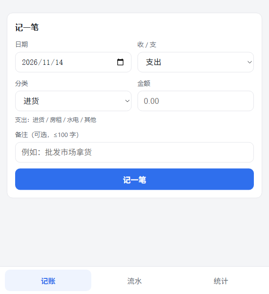
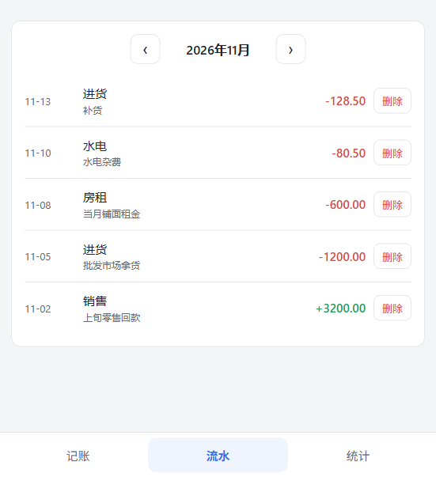
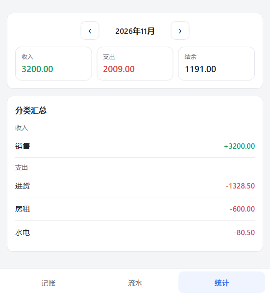

# 简易记账工具（Mini Ledger）

给家里小生意用的单机版记账小工具：能记一笔、能按月查流水、能直接看到本月收入 / 支出 / 结余。技术栈为 **Python 3 + Flask + SQLite + 原生 HTML/CSS/JS**，手写 SQL，不使用 ORM 与前端构建工具。

## 功能（本期 MVP）

- **记一笔**：录入日期、收 / 支、分类、金额、备注并写入数据库；后端独立校验。
- **流水查询**：按月筛选，按日期倒序，分页返回。
- **月度统计**：服务端计算本月收入、支出、结余及分类汇总。
- **三页前端**：记账 / 流水 / 统计三个视图，原生 JS hash 路由切换，底部导航直达，刷新保留所在视图；移动端可用（最小 360px）。
- **删除记录**：带二次确认，删除后当前列表与合计同步刷新。
- 数据落 SQLite 单文件，关闭服务再启动历史数据保留。

## 目录结构

```
mini-ledger/
├── app.py                # 路由与接口
├── db.py                 # 连接管理（get_db / close_db）
├── schema.sql            # 建表语句（含索引）
├── import_sample.py      # 可选的示例数据导入脚本
├── requirements.txt      # 依赖
├── .gitignore            # 忽略 *.db、venv/、__pycache__/
├── README.md
├── static/
│   ├── style.css
│   └── app.js
└── templates/
    └── index.html
```

## 页面结构

单模板内三个视图，由 `static/app.js` 按 `location.hash` 切换，不引入前端框架：

| 视图 | hash | 内容 | 数据来源 |
| --- | --- | --- | --- |
| 记账 | `#/record` | 日期、收/支、分类（方向联动）、金额、备注与提交 | POST `/api/records` |
| 流水 | `#/records` | 月份切换、按日期倒序列表、单笔删除、空状态 | GET `/api/records?month=` |
| 统计 | `#/stats` | 收入 / 支出 / 结余卡片 + 按分类汇总列表（收入、支出分组） | GET `/api/summary?month=` |

- 当前月份为三页共享，切视图不重置；非法 hash 回退到记账页。
- 统计页本期只做数字与分类列表，不画图表（图表列入二期）。

## 本地运行

1. 确认已安装 Python 3.10+。
2. （建议）创建虚拟环境并激活：

   ```bash
   python -m venv venv
   # Windows
   venv\Scripts\activate
   # macOS / Linux
   # source venv/bin/activate
   ```

3. 安装依赖：

   ```bash
   pip install -r requirements.txt
   ```

4. 启动服务（首次启动自动建表）：

   ```bash
   python app.py
   ```

5. 浏览器打开 <http://127.0.0.1:5000>。

可选：灌入演示数据后重启服务即可看到示例流水：

```bash
python import_sample.py
```

## 接口一览

Base URL：`/api`，请求与响应均为 JSON。

| 方法 | 路径 | 说明 |
| --- | --- | --- |
| POST | `/api/records` | 记一笔，成功 201 返回新记录 |
| GET | `/api/records?month=YYYY-MM&page=1&size=20` | 按月查询流水，倒序分页 |
| GET | `/api/summary?month=YYYY-MM` | 月度收入 / 支出 / 结余 / 分类汇总 |
| DELETE | `/api/records/<id>` | 删除记录，不存在返回 404 |

错误统一返回：

```json
{ "error": { "code": "INVALID_AMOUNT", "message": "金额必须大于 0" } }
```

错误码：`INVALID_AMOUNT`、`INVALID_DATE`、`INVALID_DIRECTION`、`INVALID_CATEGORY`、`NOTE_TOO_LONG`、`NOT_FOUND`、`INTERNAL_ERROR`。

## 数据模型

```sql
CREATE TABLE IF NOT EXISTS records (
    id          INTEGER PRIMARY KEY AUTOINCREMENT,
    happened_on TEXT    NOT NULL,
    direction   TEXT    NOT NULL CHECK (direction IN ('in','out')),
    category    TEXT    NOT NULL,
    amount      REAL    NOT NULL CHECK (amount > 0),
    note        TEXT    DEFAULT '',
    created_at  TEXT    NOT NULL DEFAULT (datetime('now','localtime'))
);
CREATE INDEX IF NOT EXISTS idx_records_date ON records (happened_on);
```

固定分类：进货 / 房租 / 水电 / 销售 / 其他。

### 设计取舍

- **金额本期用 REAL**：数据量小、精度要求低，直观优先；二期改为整数分（`amount_cents INTEGER`）存储，规避浮点误差。
- **日期存 TEXT**：SQLite 无原生日期类型，`YYYY-MM-DD` 字符串可直接范围比较与 `LIKE '2026-11%'` 筛选。
- **单表无外键**：分类为固定枚举，不建分类表；后续支持自定义分类再拆表。

## 部署上线（公网可访问）

需求目标是任意手机通过公网地址可用。推荐 **PythonAnywhere 免费版**：其提供持久磁盘，SQLite 文件不会随实例重启丢失（Render / Vercel 免费实例文件系统临时，重启会丢数据）。

大致步骤：

1. 将本仓库推送到 GitHub。
2. 在 PythonAnywhere 新建 Web 应用，选择 Flask，填入仓库地址并拉取。
3. 在虚拟环境中 `pip install -r requirements.txt`，把工作目录与 WSGI 指向 `app.py` 的 `app` 对象。
4. 确保 `ledger.db` 位于持久磁盘路径；`.gitignore` 已忽略 `.db`，上线后在服务器侧保留一份数据库副本。
5. 通过分配的域名用手机浏览器打开，验证记账、刷新留存、合计正确。

> 部署账号、域名与 WSGI 配置需在实际上线环境完成；本仓库代码不包含远程仓库地址。

## 安全与工程约定

- 全部 SQL 使用参数化查询（`?` 占位），禁止字符串拼接。
- 前端渲染用户输入使用 `textContent`，不使用 `innerHTML`，防 XSS。
- 数据库连接通过 Flask `g` 管理，`teardown_appcontext` 关闭；开启 WAL 模式。
- 仓库不含 `.db`、`venv/`（见 `.gitignore`）。

## 二期规划（寒假，本期不做）

1. 用 Vue 重写前端（组件化、状态管理）。
2. 金额改为整数分存储。
3. 引入 SQLAlchemy，做数据层抽象。
4. 增加图表（月度趋势、分类占比）。
5. 支持编辑记录与自定义分类。
6. 切换 MySQL，练习数据库迁移。

## 截图

记账页 / 流水页 / 统计页：







> 手机端视图可在本地启动后，用浏览器开发者工具切换到 375px 宽度查看；窄屏样式见 `static/style.css` 中 `@media (max-width: 480px)` 断点。
